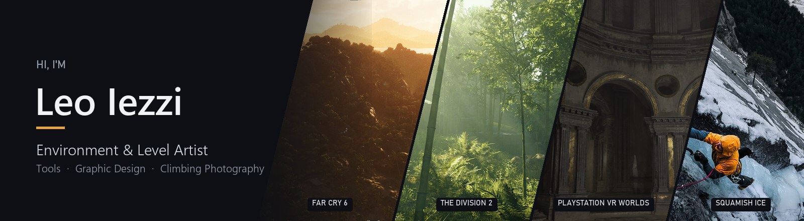
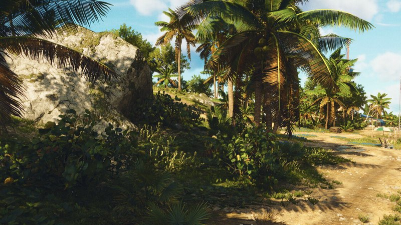
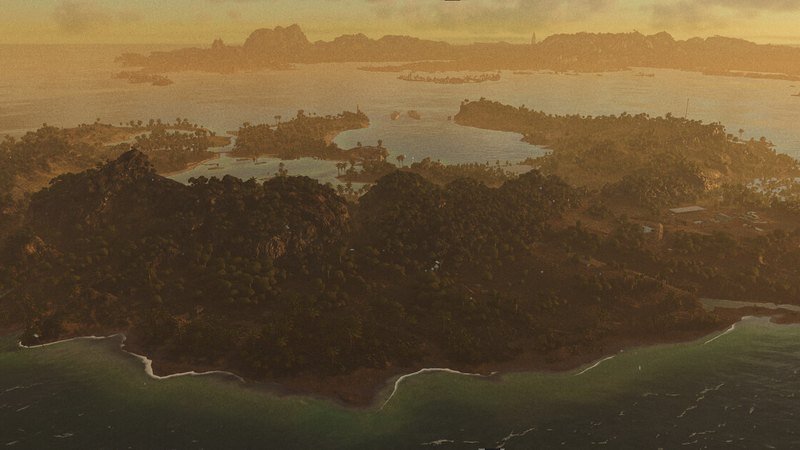
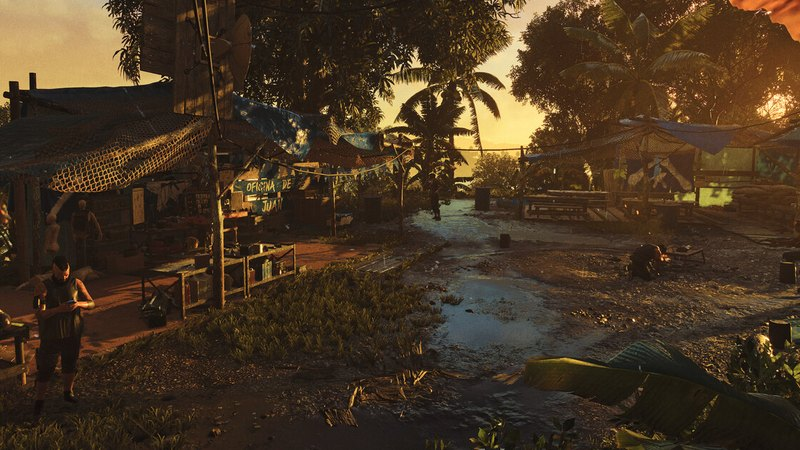
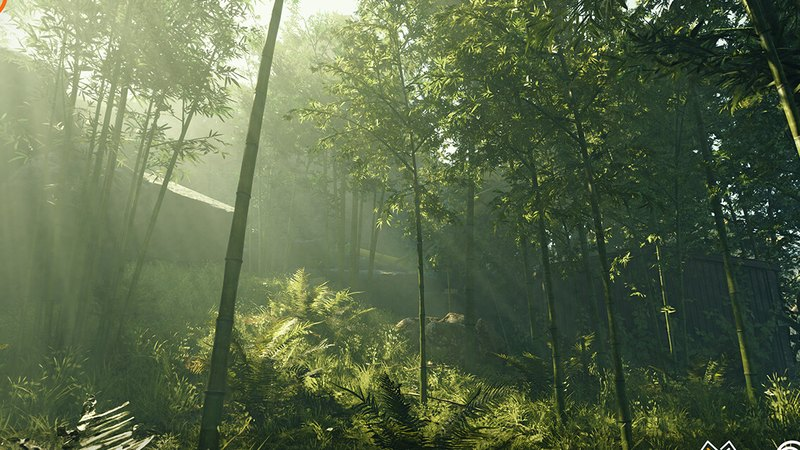
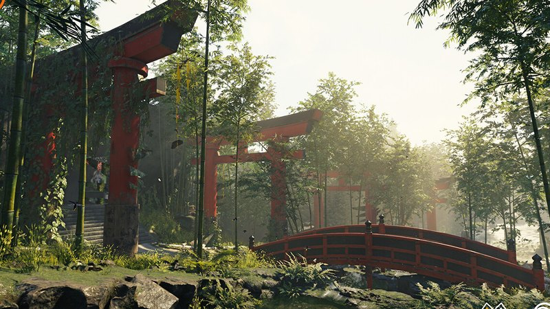
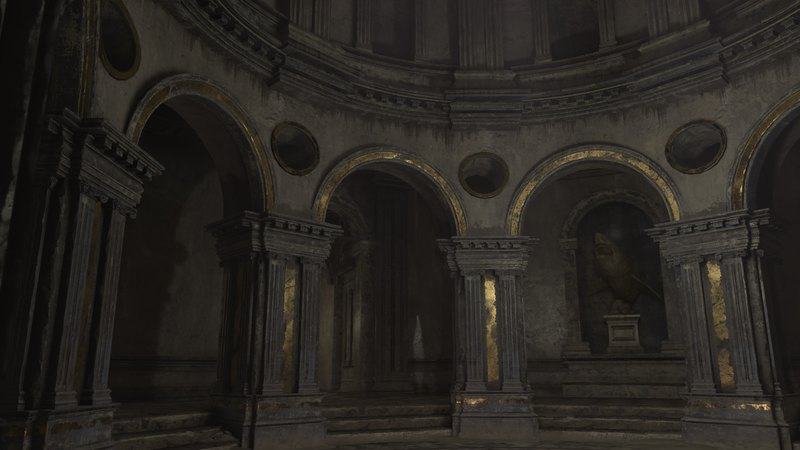
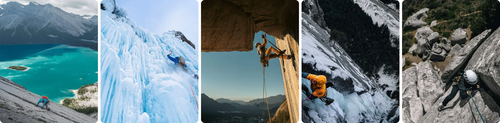

  <a href="https://leonano.com"><b>Portfolio</b></a> &nbsp;·&nbsp;
  <a href="https://www.artstation.com/leonano"><b>ArtStation</b></a> &nbsp;·&nbsp;
  <a href="https://www.linkedin.com/in/leonano/"><b>LinkedIn</b></a> &nbsp;·&nbsp;
  <a href="https://leoiezzi.com"><b>Climbing Photography</b></a> &nbsp;·&nbsp;
  <a href="https://www.instagram.com/leonano/"><b>Instagram</b></a> &nbsp;·&nbsp;
  <a href="https://x.com/leonanodotcom"><b>X</b></a>

I'm Leo, an Italian environment and level artist based in **Squamish, BC**. I've spent 15+ years building
AAA worlds, from early graphic-design work in Italy to open worlds at Ubisoft and Microsoft.
I like environments that tell a story, and I like the tools that make them faster to build.

- 🌲 **Now:** building worlds at [**Arcanaut Studios**](https://www.playnews.gg/en/studios/arcanaut-studios)
- 🛠️ **On the side of the art:** Unreal Engine editor tools and plugins in C++ and Python for blockouts, Level Instances, World Partition and performance
- 🎨 **Background:** graphic designer first, and it still shapes how I compose a shot or lay out a space
- 🧗 **Off the clock:** climbing, ice climbing and shooting both around the Sea to Sky
- 🎓 **Giving back:** I [mentor](https://leonano.com/pages/mentorship) environment artists on planning, pre-production and teamwork

---

### 🗺️ Worlds I've helped build

  
  
  
   
  <b>Far Cry 6</b>: Libertad Island · Santuario Island · Clara's Camp

  
  
  
   
  <b>The Division 2</b>: Manning National Zoo · <b>PlayStation VR Worlds</b>: Hub

| Studio | Work |
| :-- | :-- |
| **Arcanaut Studios** | Current. Environments and in-editor tooling |
| **The Coalition** (Microsoft) | Lead Level Artist |
| **PUBG** (KRAFTON) | Expert World Builder |
| **Ubisoft Reflections** | Senior Level / Environment Artist on *Far Cry 6* and *Tom Clancy's The Division 2* |
| **Sony London Studio** | Environment Artist on *PlayStation VR Worlds* |
| **LKA** · **Contenano** · Italy | *The Town of Light*; co-founded an asset studio; graphic design |

---

### 🧰 Toolbox

  

`ZBrush` `Substance Designer` `Substance Painter` `Mari` `SpeedTree` `Marmoset Toolbag` `Snowdrop` `Photogrammetry` `Perforce` `World Partition`

---

### ✍️ Tutorials & writing

- [Normal Edge Decals for game environments](https://leonano.com/projects/l3wwa)
- [Super Bool Tool + boolean workflow recap](https://leonano.com/projects/laWOo)
- [All you need to know about texel density](https://leonano.com/projects/qbOqP)
- [No more wrong normal maps!](https://leonano.com/projects/nNXyK)
- [A workflow to bake details from ZBrush to low poly](https://leonano.com/projects/3BqVv) · also on [80.lv](https://80.lv/author/leonardo-iezzi)

---

### 🧗 Off the clock

I shoot rock and ice climbing around Squamish and beyond ([leoiezzi.com](https://leoiezzi.com)), and I volunteer
my design, web and photo skills for the local climbing community:

- [**Squamish Access Society**](https://squamishaccess.ca): stewardship and access for the crags of the Sea to Sky
- **Sea to Sky Bolt Fund**: funding new bolts and anchors for local route developers

📍 Squamish, BC · Made between the editor and the crag

